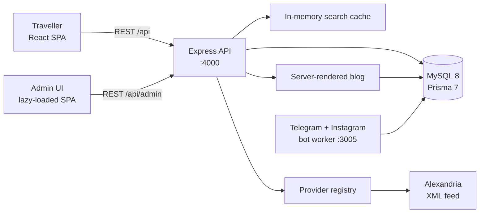

# SkyTravel

A tour search site and back office for a Czech travel agency, running at
[sky-travel.tours](https://sky-travel.tours).

The agency doesn't run its own tours. It resells holiday packages from a supplier
called Alexandria, which publishes its whole catalogue as one large XML feed:
thousands of offers, prices that change every day. That feed is fine for a computer
and useless for a customer.

So the project does two jobs. It turns the feed into a catalogue people can
actually browse, filter and compare. And it gives the agency somewhere to work the
leads that come out of it: inquiries, price alerts, email campaigns, follow-ups.

Both halves live in this repo, along with the Telegram bot that talks to leads and
sends the owner a report every Monday.

## What a visitor can do

- Search the supplier catalogue without knowing which resort or hotel they want
- Filter by destination, dates, nights, board, hotel stars, transport and price
- Compare up to four offers side by side
- Open a tour detail page with photos, a price breakdown and an inquiry form
- Save favourites and subscribe to a price alert for a specific tour
- Read Czech destination guides on the blog (Bulgaria, Croatia, Greece, Italy,
  Spain, and a general "how to pick a package holiday" article)

The site is in Czech by default, with English, Ukrainian and Russian available
from the language switcher.

## What the agency can do

- See leads as they arrive, with the tour and destination attached
- Delete a person's data on request, which is a GDPR requirement here
- Build email campaigns in a rich-text editor and send them to a filtered list
- Watch supplier syncs and see when the feed last updated
- Read monthly statistics: inquiry counts, marketing consent rate, which
  destinations people ask about
- Check an audit log of what every admin account has done
- Get a report in Telegram every Monday morning, without logging in anywhere

## How it fits together



Three processes, one database:

- **Client** runs in the browser and talks to the API with plain `fetch`. No
  GraphQL, no React Query, no state library beyond one small Zustand store for the
  search flow.
- **Server** is the only thing that talks to the supplier. It also renders the blog
  to HTML and serves the sitemap and RSS.
- **Bots** run as a separate PM2 process, so a Telegram hiccup can't take the site
  down. The worker answers people in Telegram, follows up with them on day 3, 7, 14
  and 30, and posts the Monday report.

[docs/architecture.md](docs/architecture.md) goes through the request lifecycle and
the caching in more detail.

## Where the interesting work is

**Adding a supplier is one file.** Every feed implements the same `TourProvider`
interface, and routes only ask the registry for a provider. Supporting a second
supplier means writing one file and registering it, not touching routes or React
components. The interface is in
[server/src/providers/types.ts](server/src/providers/types.ts).

**Search survives a supplier outage.** Results are cached in memory for a few
minutes, with single-flight so a burst of identical requests only hits the supplier
once. When the feed is down, country landing pages fall back to the last copy of the
tours stored in MySQL. Visitors get slightly stale prices instead of an error page.

**The blog is real HTML.** Articles are markdown files rendered on the server, with
destination hubs, canonical URLs, RSS, sitemap and JSON-LD. Google reads the article
body without running any JavaScript, which matters when organic traffic is the main
acquisition channel.

**Admin code never reaches visitors.** The whole back office is a lazy-loaded chunk
behind session auth, so an anonymous visitor downloads none of it.

## Stack

| Layer   | What's used                                                                          |
| ------- | ------------------------------------------------------------------------------------ |
| Client  | React 18, React Router 6, Zustand 5, Tailwind v4, Radix UI, TipTap, Vite 8           |
| Server  | Express 4, Prisma 7, MySQL 8, Zod, pino, express-session, bcryptjs, nodemailer       |
| Bots    | grammY (Telegram), Instagram webhook, node-cron                                      |
| Tests   | Node test runner + tsx (server), Vitest + Testing Library (client), Playwright (E2E) |
| Tooling | ESLint 9, Prettier, Husky, lint-staged, commitlint, GitHub Actions                   |

All of it is TypeScript in strict mode and ESM throughout.

## Where things live

```
skytravel/
├── client/                 React SPA
│   └── src/
│       ├── api/            Typed fetch helpers and caches
│       ├── components/     Shared UI
│       ├── features/       Search, compare and admin modules
│       ├── hooks/          Favourites, language, lead popup, cookie consent
│       ├── pages/          Route-level screens
│       └── stores/         Zustand store (search flow only)
├── server/                 Express API
│   ├── prisma/             Schema, migrations, seed
│   ├── content/blog/       Markdown articles
│   └── src/
│       ├── providers/      TourProvider contract + Alexandria implementation
│       ├── routes/         Public and admin endpoints
│       ├── middleware/     Auth, CSRF, rate limits, uploads, errors
│       ├── blog/           Markdown loader, renderer, sitemap, RSS
│       └── lib/            Logger, cache, mailer, i18n
├── bots/                   Telegram + Instagram worker
├── e2e/                    Playwright specs
├── docs/                   Architecture, API, database, providers, runbook
└── scripts/                Deploy and backup scripts
```

## Running it locally

You need Node 20 or newer and MySQL 8 running on your machine.

```bash
git clone https://github.com/danilgorbunofff/skytravel.git
cd skytravel

npm ci

cp server/.env.example server/.env      # database, supplier key, admin login
cp client/.env.example client/.env      # VITE_API_URL=http://localhost:4000

npm --workspace server run prisma:migrate
npm run dev
```

That starts both apps:

| What   | Where                             |
| ------ | --------------------------------- |
| Client | http://localhost:5173             |
| API    | http://localhost:4000/api/health  |
| Admin  | http://localhost:5173/admin-login |

The bot worker is optional. Run it with `npm run dev:bots` after creating
`bots/.env` from its example file.

Every environment variable is documented in [docs/env.md](docs/env.md). The ones you
can't skip are `DATABASE_URL`, `SESSION_SECRET`, `ADMIN_LOGIN`, `ADMIN_PASSWORD` and
the Alexandria credentials. Email features turn themselves off if the `SMTP_*`
variables are missing.

## Tests

```bash
npm --workspace server run test     # API unit + integration tests
npm --workspace client run test     # Client unit tests
npm run test:e2e                    # Playwright, needs `npm run dev` running
```

At the time of writing that's 267 tests on the server and 87 on the client.

Server tests talk to a real MySQL database, so create one first:

```bash
mysql -u root -e "CREATE DATABASE IF NOT EXISTS skytravel_test"
DATABASE_URL=mysql://root@localhost:3306/skytravel_test npm --workspace server run test
```

## Deploying

Production is a single Hetzner VPS: nginx in front, PM2 running the API, the built
client and the bot worker. Pushing to `main` triggers the GitHub Actions workflow,
which builds, runs `prisma migrate deploy` and reloads PM2 over SSH.

[docs/runbook.md](docs/runbook.md) has the manual deploy, the backup procedure and
what to do when something breaks at 2am.

## Known gaps

Worth saying out loud before someone finds them:

- Only one supplier is integrated. The provider interface exists for more, but
  there's nothing to test a second one against yet.
- The cache is in-process, so it doesn't survive a restart and won't work across
  multiple API instances. Swapping it for Redis is a contained change.
- No booking or payments. The site ends at an inquiry, because the agency closes
  sales by phone.
- Statistics cover counts and destinations, not revenue.

## Docs

| Document                                         | Contents                                      |
| ------------------------------------------------ | --------------------------------------------- |
| [docs/architecture.md](docs/architecture.md)     | System design, request flow, design decisions |
| [docs/api.md](docs/api.md)                       | REST endpoint reference                       |
| [docs/database.md](docs/database.md)             | Prisma schema and data model                  |
| [docs/providers.md](docs/providers.md)           | Provider contract and caching                 |
| [docs/provider-guide.md](docs/provider-guide.md) | Step-by-step guide to adding a supplier       |
| [docs/env.md](docs/env.md)                       | Every environment variable                    |
| [docs/runbook.md](docs/runbook.md)               | Deployment, backups, monitoring, recovery     |
| [CONTRIBUTING.md](CONTRIBUTING.md)               | Local workflow and conventions                |

## License

Private project, all rights reserved.
